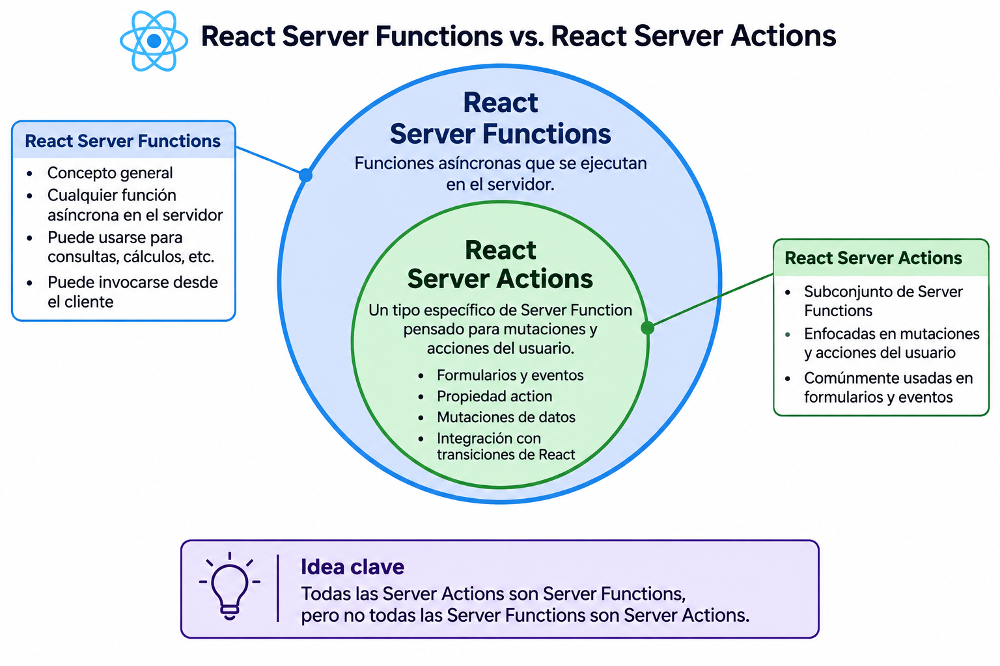
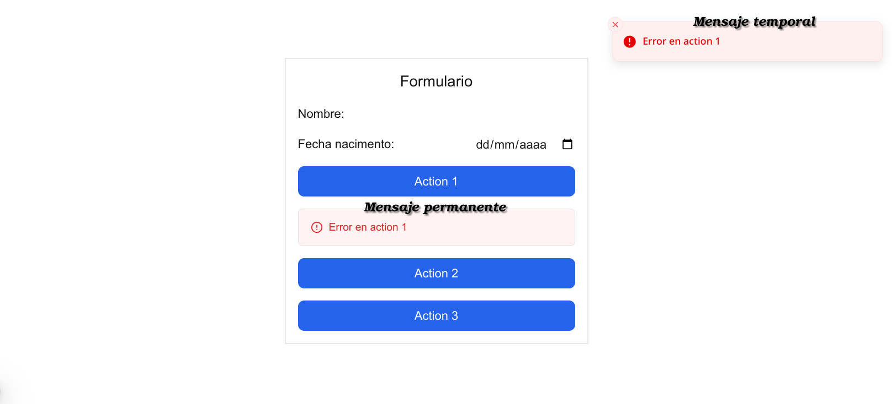
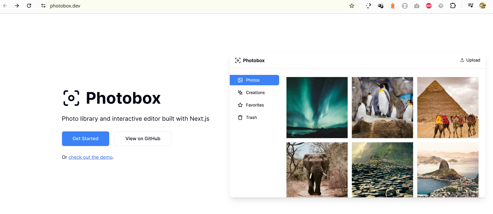

> DESARROLLO WEB EN ENTORNO SERVIDOR

# Tema 5: FORMULARIOS  <!-- omit in toc -->
> Generación dinámica de páginas Web  
> SERVER ACTIONS, FORMULARIOS, IMÁGENES 

**[`PROYECTOS DE EJEMPLO`](PROYECTOS.md)**


---
- [1. Introducción](#1-introducción)
- [2. Formularios y acciones](#2-formularios-y-acciones)
  - [2.1. POST vs GET](#21-post-vs-get)
    - [2.1.1. POST](#211-post)
    - [2.1.2. GET](#212-get)
  - [2.2. Consejos](#22-consejos)
    - [2.2.1. Usa **`button`** siempre con la propiedad `type`.](#221-usa-button-siempre-con-la-propiedad-type)
    - [2.2.2. Usa **`input`** con propiedades y valor del tipo adecuado](#222-usa-input-con-propiedades-y-valor-del-tipo-adecuado)
    - [2.2.3. Usa **`label`** correctamente](#223-usa-label-correctamente)
    - [2.2.4. Usa **`defaultValue`** y **`value`** correctamente](#224-usa-defaultvalue-y-value-correctamente)
    - [2.2.5. Usa **`disabled`** y **`readOnly`** correctamente](#225-usa-disabled-y-readonly-correctamente)
    - [2.2.6. Usa **`select`** correctamente](#226-usa-select-correctamente)
- [3. Server Actions](#3-server-actions)
  - [3.1. Crear acciones del servidor](#31-crear-acciones-del-servidor)
  - [3.2. Ejecutar acciones del servidor](#32-ejecutar-acciones-del-servidor)
  - [3.3. Gestiona los valores que recibe la acción del servidor](#33-gestiona-los-valores-que-recibe-la-acción-del-servidor)
  - [3.4. ¿Qué hace la acción del servidor al finalizar?](#34-qué-hace-la-acción-del-servidor-al-finalizar)
- [4. Caché de datos en el servidor (Server Data Cache)](#4-caché-de-datos-en-el-servidor-server-data-cache)
  - [4.1. Introducción](#41-introducción)
  - [4.2. Activar Cache Components](#42-activar-cache-components)
  - [4.3. Funcionamiento de Cache Components](#43-funcionamiento-de-cache-components)
  - [4.4. Lectura de datos (Read)](#44-lectura-de-datos-read)
  - [4.5. Mutación de datos (Create, Update y Delete)](#45-mutación-de-datos-create-update-y-delete)
  - [4.6. ¿Cuándo utilizar updateTag(), revalidateTag() y revalidatePath()?](#46-cuándo-utilizar-updatetag-revalidatetag-y-revalidatepath)
  - [4.7. Consideraciones importantes](#47-consideraciones-importantes)
  - [4.8. Conclusión](#48-conclusión)
- [5. Funciones del lado cliente](#5-funciones-del-lado-cliente)
  - [5.1. useFormStatus](#51-useformstatus)
  - [5.2. useActionState: simplificando lo anterior](#52-useactionstate-simplificando-lo-anterior)
  - [5.3. Usando un envoltorio (wrapper)](#53-usando-un-envoltorio-wrapper)
  - [5.4. Un método unificado de trabajo](#54-un-método-unificado-de-trabajo)
  - [5.5. Ejemplo práctico: Formulario con feedback](#55-ejemplo-práctico-formulario-con-feedback)
- [6. Validación de datos](#6-validación-de-datos)
  - [6.1. Validación en el cliente](#61-validación-en-el-cliente)
  - [6.2. Validación en el servidor](#62-validación-en-el-servidor)
    - [6.2.1. Ataques frecuentes](#621-ataques-frecuentes)
    - [6.2.2. Sé paranoico: nunca confíes en tus usuarios](#622-sé-paranoico-nunca-confíes-en-tus-usuarios)
    - [6.2.3. Resumen](#623-resumen)
  - [6.3. Ejemplo práctico: Formulario con validación en el servidor](#63-ejemplo-práctico-formulario-con-validación-en-el-servidor)
- [7. ANEXO: Casos prácticos avanzados](#7-anexo-casos-prácticos-avanzados)
  - [7.1. Panel de gestión de escuela (Parte 1 de 2)](#71-panel-de-gestión-de-escuela-parte-1-de-2)
  - [7.2. Albúm de fotos](#72-albúm-de-fotos)
- [8. Referencias](#8-referencias)


--- 

# 1. Introducción

El envío de información por parte del usuario al servidor se realiza a través de formularios. Por tanto su correcto manejo es de gran importancia.

En este tema veremos, principalmente, como trabajar con formularios en NextJS, lo cual requiere de un servidor que sea capaz de procesar los datos enviados desde ellos. Podemos hablar de proceamiento en el servidor, muchas veces también conocido como generación dinámica de páginas, en el caso que se devuelva al usuario una página de respuesta.

Como comparativa para constrastar, también incluimos en este tema la técnica `SSG`, que es lo contrario de la generación dinámica de páginas. Es la generación estática de páginas durante el despliegue o construcción de la aplicación. Después de generadas las páginas, el servidor no necesitará realizar procesamiento alguno y por tanto su función se limitará a servir contenido estático, lo cual aumenta el rendimiento y requiere de servidores más simples y menos costosos.


# 2. Formularios y acciones

El uso de formularios para la recogida de datos y su envío al servidor es una tarea muy habitual. 

El diseño e implementación de formularios y sus *inputs* y *buttons* asociados no es tan trivial como puede parecer a primera vista. En este tema estudiaremos las bases para ello, y veremos las diferencias entre la forma en la que se trabaja en HTML frente a JSX. Existen algunas pequeñas diferencias que son clave y que pueden complicarnos la vida cuando no se conocen.  


**Varias acciones dentro de un formulario**

La forma tradicional, y más intuitiva, de gestionar la información de un formulario es vinculándolo a una **acción de servidor**.   

Además es posible indicar varias **acciones** dentro del formulario, lo cual puede ser muy interesante cuando deseamos realizar distintas operaciones con los datos.

En HTML, los `input` y `button` pueden tener un atributo [**`formAction`**](https://www.w3schools.com/tags/att_formaction.asp) . Con ello, dentro de un formulario podemos hacer llamadas a distintas acciones en el servidor.

NextJS, emplea una técnica similar, como se muestra en el siguiente código JSX:

```html
    <form>
          <input type='hidden' name='id' defaultValue={user.id} />

          <label htmlFor='nombre'>Usuario</label>
          <input type='text' id='nombre' name='nombre' defaultValue={user.nombre} />

          <label htmlFor='edad'>Edad</label>
          <input type='text' id='edad' name='edad' defaultValue={user.edad} />

          <button type='submit' formAction={userUpdate}>Actualizar</button>
          <button type='submit' formAction={userDelete}>Eliminar</button>
    </form>
```

Esto es muy útil si disponemos de un formulario con datos, por ejemplo de un usuario, y queremos realizar distintas acciones: actualizar, eliminar, ...


[Código fuente con ejemplo completo](https://github.com/jamj2000/nxform)


## 2.1. POST vs GET

La información recogida en un formulario puede enviarse al servidor de 2 maneras distintas:

- **POST** 
- **GET**

### 2.1.1. POST

Cuando usamos el método POST, **la información se envía en el cuerpo de la petición** y no es visible para el usuario. 

**Esta es la forma recomendada en la mayoría de los casos**, por ejemplo:

- Hay campos con información confidencial, como puede ser contraseñas y similar.
- Hay gran cantidad de información a enviar al servidor, como muchos inputs, textareas, ...
- Necesitamos enviar archivos al servidor mediante `input type='file'`.

Es habitual su uso para enviar información de un formulario para su procesamiento en el servidor. Las operaciones que se realizan, normalmente sobre una BD, son:

- **Inserción**
- **Modificación**
- **Eliminación**

Este método también se usa en operaciones de autenticación, como:

- **Registro**
- **Login**
- **Logout**
  

En **JSX** se escribe de la siguiente forma:

```js
<form  action={...}>

  {/* Elementos del formulario */}

</form>
```

> [!NOTE]
> 
> `action` es una función asíncrona ejecutada en el servidor, por ejemplo `action={insertarProducto}`

Su equivalencia en **HTML** es la siguiente:


```html
<form  action="..."  method="POST"  enctype="multipart/form-data">

  <!-- Elementos del formulario -->

</form>
```

> [!NOTE]
> 
> En HTML, 
> - si no indicamos atributo `method`, se toma por defecto el valor `method="GET"`
> - si no indicamos atributo `enctype`, se toma por defecto el valor `enctype="application/x-www-form-urlencoded"`. 
>  
> Sin embargo en JSX, en el componente `form` (con f minúscula), de forma implícita, por defecto es  `method="POST"` y `enctype="multipart/form-data"`. Esto último permite el uso de `input type="file"`, y por tanto la subida de archivos al servidor.  
>
> Además **en JSX, no debemos indicar `method` ni `enctype`**, puesto que dará error.


### 2.1.2. GET

Cuando usamos el método GET, **la información se envía en la URL de la petición** y es visible para el usuario.

Su uso es menos habitual, aunque es adecuado en el siguiente caso:

- Necesitamos enviar poca información al servidor y deseamos que esa información sea pública.

Suele usarse para enviar información de filtrado en la URL de una página, por ejemplo:

http://www.example.com/products **?query=laptop&sort=price&page=2**

Esta información de filtrado suele clasificarse en 3 categorías:

- **Búsqueda**
- **Ordenación**
- **Paginación**

En JSX se escribe de la siguiente forma:

```js
import Form from 'next/form'; // IMPORTANTE. Necesario importar. 

// ...

<Form  action="...">

  <input name='query' {/* ... */} />
  <input name='sort'  {/* ... */} />
  <input name='page'  {/* ... */} />

</Form>
```

> [!TIP]
> 
> Observa que es necesario importar el componente, y que éste debe escribirse con la primera letra en mayúsculas. Este componente está disponible a partir de NextJS 15


> [!TIP] 
> 
> `action` es la página que recibirá la información en forma de parámetros de consulta, por ejemplo `action="/productos"`.  Cuando tenemos `action=""`, significa que la información será enviada a la misma página donde está el formulario.


> [!IMPORTANT] 
> 
> En HTML, 
> - si no indicamos atributo `method`, se toma por defecto el valor `method="GET"`
> - si no indicamos atributo `enctype`, se toma por defecto el valor `enctype="application/x-www-form-urlencoded"`. 
>  
> **En JSX**, en el componente `Form` (con F mayúscula), también es así, pero **no debemos indicar `method` ni `enctype`, puesto que dará error**.


Su equivalencia en HTML es la siguiente:

```html
<form  action="..."  method="GET"  enctype="application/x-www-form-urlencoded">

  <input name='query' <!-- ... --> />
  <input name='sort'  <!-- ... --> />
  <input name='page'  <!-- ... --> />

</form>
```

[Proyecto de ejemplo](https://github.com/jamj2000/nxform-filter)

## 2.2. Consejos

Aunque JSX se parece mucho a HTML, tiene algunas peculiaridades que pueden complicar la vida al desarrollador que no las conozca.   

Aquí van algunos consejos:


### 2.2.1. Usa **`button`** siempre con la propiedad `type`.

En Next.js, si usas un `<button>` sin especificar la propiedad `type`, su comportamiento es el mismo que en HTML estándar, es decir por defecto es `type="submit"`

```js
<button>
    Guardar
</button>
```

Este botón se comporta como si hubieras escrito:

```js
<button type="submit">
    Guardar
</button>
```

Esto significa que:

- Si estás dentro de un `<form>`, al hacer clic en el botón se enviará el formulario (es decir, se ejecutará la acción del formulario).

- Esto puede causar comportamientos inesperados si tú pretendías que ese botón solo hiciera algo en el cliente (como cerrar un modal, limpiar campos, etc.).


**✅ Buenas prácticas en Next.js (y React en general)**

Siempre declara explícitamente el `type`, para evitar errores:

| Comportamiento deseado      | Código recomendado                        |
| --------------------------- | ----------------------------------------- |
| Enviar el formulario        | `<button type="submit">Enviar</button>`   |
| Botón sin enviar formulario | `<button type="button">Cancelar</button>` |
| Reiniciar el formulario     | `<button type="reset">Reiniciar</button>` |

**⚠️ Errores comunes**

Si usas un botón dentro de un formulario y no especificas `type="button"`, puede causar errores como envíar el formulario sin querer

```js
<form>
  <button onClick={() => cerrarModal()}> // ¡Envía el formulario sin querer!
    Cancelar
  </button> 
</form>
```
Solución:

```js
<form>
  <button type="button" onClick={() => cerrarModal()}>
    Cancelar
  </button>
</form>
```

En resumen

✅ **Si no especificas type, el valor por defecto es submit.**  
🛠️ Es buena práctica declarar siempre type explícitamente.  
🧠 Esto es HTML estándar, no algo específico de Next.js.  


### 2.2.2. Usa **`input`** con propiedades y valor del tipo adecuado

A diferencia de HTML donde todos los valores de las propiedades son de tipo string, en JSX el valor para algunas propiedades debe ser `number` o `boolean`. 

A continuación se muestran ejemplos de **código JSX** con errores y correcto.

**MAL ❌**

```js
<input type="number" min="1" max="100" />  // Permitido en HTML. No permitido en JSX
<input required="true" disabled="true" />  // Permitido en HTML. No permitido en JSX
<input required disabled />                // Permitido en HTML. Permitido en JSX
```

**BIEN ✅**

```js
<input type="number" min={1} max={100} />  // Correcto en JSX
<input required={true} disabled={true} />  // Correcto en JSX
<input required  disabled />               // Correcto en JSX     
```

### 2.2.3. Usa **`label`** correctamente

**MAL ❌**

```js
<label>Número:</label>                              // Provoca warning en JSX
<input id="num" type="number" min={1} max={100} />   
```

**BIEN ✅**

```js
<label htmlFor="num">Número: </label>                  
<input id="num" type="number" min={1} max={100} />  
```

**BIEN ✅**

```js
<label>Número:                   
  <input type="number" min={1} max={100} />  
</label>  
```

### 2.2.4. Usa **`defaultValue`** y **`value`** correctamente

La mayoría de las veces la propiedad que necesitaremos usar en un `input` es `defaultValue`. Pero existen algunos casos en que necesitaremos hacer uso de `value`. 

A continuación tienes los contextos en los que se usa cada propiedad:

| Propiedad      | Contexto                                            |
| -------------- | --------------------------------------------------- |
| **`value`**    | Para valores asociados a una variable de **estado** |
| `defaultValue` | Para valores no asociados a una variable de estado  |


Ejemplo:


```js
'use client'
import { useState } from 'react';


export default function Cuadrado({ long, width }) {

    const [largo, setLargo] = useState(long)
    const [ancho, setAncho] = useState(width)

    return (
        <form>
            <label> Escala:
                <input type="number" name="escala" step={0.01}
                    defaultValue={1}    // Correcto. No asociado a variable de estado   
                />
            </label>
            <label> Largo:
                <input type="number" name="largo" step={0.01}
                    onChange={(e) => setLargo(e.target.value)}
                    value={largo}      // Correcto. Variable de estado
                />
            </label>
            <label> Ancho:
                <input type="number" name="ancho" step={0.01}
                    onChange={(e) => setAncho(e.target.value)}
                    value={ancho}       // Correcto. Variable de estado
                />
            </label>
            <label> Área:
                <input type="number" name="area" readOnly
                    value={largo * ancho}   // Correcto. Valor derivado del estado
                    onChange={() => {}}
                />
            </label>  
        </form>
    )
}
```

> [!NOTE]
>
> React, y por tanto JSX, distingue entre **entradas controladas** y **entradas no controladas**.
> 
> Una entrada como `<input />` no está controlada. Incluso si pasamos un valor inicial como `<input defaultValue="Initial text" />`, JSX solo especifica el valor inicial. No controla cuál debería ser el valor en otro momento.      
>
> Para representar una **entrada controlada**, le pasamos la propiedad **`value`** (o `checked` para los checkbox y radio). React forzará que la entrada coincida siempre con dicho valor. Este valor se guarda en una variable de estado, que es actualizada  con un gestor de eventos. Ejemplo:
>
> ```js
>function Form() {
>  const [firstName, setFirstName] = useState(''); // Declaramos variable de estado ...
>  // ... 
>  return (
>    <input
>      // ...forzamos que el valor del input value coincida con el la variable de estado...
>      value={firstName} 
>      // ... y actualizamos la variable de estado en cada cambio
>      onChange={e => setFirstName(e.target.value)}
>    />
>  );
>}
>```
>
> Referencia: https://react.dev/reference/react-dom/components/input#controlling-an-input-with-a-state-variable

### 2.2.5. Usa **`disabled`** y **`readOnly`** correctamente

Las propiedades `disabled` y `readOnly` se comportan de forma parecida en un `input`. **En ambos casos, el usuario no podrá modificar el valor del input**.

La principal diferencia es la siguiente:

- cuando usamos `readOnly` el valor SÍ será enviado al servidor.
- cuando usamos `disabled` el valor NO será enviado al servidor.

Ejemplo:

```js
export default Formulario (  ) {

  return (
   <form action={action}>
              <label> Número 1:
                <input  type="number"  name="num1"  step={0.01}
                  defaultValue={ 1 }   
                />
              </label>

              <label> Número 2:
                <input  type="number"  name="num2"  step={0.01}
                  defaultValue={ 2 }
                  readOnly         // Valor no modificable. SÍ se envía al servidor                      
                />
              </label>  

              <label> Número 3:
                <input  type="number"  name="num3"  step={0.01} 
                  defaultValue={ 3 }  
                  disabled         // Valor no modificable. NO se envía al servidor 
                />  
              </label>

              <button type="submit"> </button>
    </form>
  )
}
```


> [!NOTE]
>
> El componente `fieldset` también admite la propiedad `disabled`. A menudo esto es útil para deshabilitar un grupo de inputs. Sin embargo tiene el inconveniente de que los valores de los *inputs* dentro del *fieldset disabled* no serán enviados al servidor.
> 
> El componente `fieldset` no admite la propiedad `readOnly`. 

> [!IMPORTANT]
>
> Recuerda que los valores de los componentes `input`, `select`, `textarea`, ... no se enviarán al servidor si están dentro de un `fieldset disabled`. 
> 
> De la misma manera, tampoco se lanzarán las acciones de los componentes `button` que estén dentro de dicho componente.


> [!NOTE] 
> 
> La propiedad `readOnly` sólo se aplica a `input` y `textarea`. No tiene efecto con `fieldset` ni con `select`.    


### 2.2.6. Usa **`select`** correctamente

Hay algunas diferencias al usar `select` y `option` en JSX con respecto a su uso en HTML.

En HTML hacemos

```html
<select name="localidad">
      <option value="1"> Álava </option>
      <option value="2"> Albacete </option>
      <option value="3" selected> Almeria </option>
      <option value="4"> Ávila </option>
</select>
```

En JSX debemos hacer

```js
<select
  key={3}
  name="localidad"
  defaultValue={3}>
      <option value={1}> Álava </option>
      <option value={2}> Albacete </option>
      <option value={3}> Almeria </option>
      <option value={4}> Ávila </option>
</select>
```
A diferencia de HTML, no se admite pasar el atributo `selected` a `option`. Para indicar la opción seleccionada por defecto usamos `defaultValue`.

Por otro lado, cuando usamos array de objetos y los recorremos con el método `map`, el formato a seguir es el que aparece a continuación:


```js
<select
  key={localidadId}
  name="localidad"
  defaultValue={localidadId} >
    {localidades.map(localidad => (
        <option key={localidad.id} value={localidad.id}> {localidad.nombre} </option>
    ))}
</select>
```

> [!TIP]
> 
> **CONSEJO IMPORTANTE**
>
> Usa siempre una propiedad **key** en el select, cuando trabajes con entrada no controlada. 
> El valor de dicha propiedad debe ser dinámico, y cambiar cuando el usuario seleccione una opción distinta a la anterior.
>
> El motivo es que [React trabaja con un Virtual DOM y necesita saber que un elemento ha cambiado para sincronizar cambios con el DOM](https://www.escuelafrontend.com/prop-key-en-react). 
> 
> Si no lo hacemos así los cambios realizados en VDOM no se verán reflejados en el DOM. 
 
      
- Referencia: [Documentación de React acerca de select](https://react.dev/reference/react-dom/components/select)


# 3. Server Actions

**Las acciones de servidor son funciones asíncronas que serán ejecutadas en el servidor**. Fueron introducidas en NextJS 13. 

**Se usan habitualmente para procesar, en el lado servidor, datos procedentes de un formulario.**

> [!NOTE]
>
> Las [`Acciones de Servidor (Server Actions)`](https://nextjs.org/docs/app/guides/server-actions) forman parte de un conjunto más amplio denominado [`Funciones de Servidor (Server Functions)`](https://react.dev/reference/rsc/server-functions)
> 
> 
>
> **Ejemplo de función de servidor**
>
> ```js
> 'use server';
>
> export async function getUser(id) {
>  return await db.user.findUnique({
>    where: { id }
>  });
> }
> ```
>
> **Ejemplo de acción de servidor**
>
> ```js
> 'use server';
>
> export async function createUser(formData) {
>  await db.user.create({
>    data: {
>      name: formData.get('name')
>    }
>  });
>}
> ```


## 3.1. Crear acciones del servidor

Personalmente recomiendo, para mejor organización y con fin a obtener un código más legible, colocar todas las `server actions` en un archivo o archivos separados. Un archivo puede contener varias acciones del servidor.

Al principio del archivo, debe colocarse la directiva `use server`, que evitará que dicho código sea enviado al cliente, lo cual resultaría en un problema de seguridad además de producir un fallo del funcionamiento esperado.

Una buena práctica es organizar los archivos de forma similar a la siguiente:

```
src
├── app
│   ├── dashboard
│   │   └── page.js
│   ├── favicon.ico
│   ├── globals.css
│   ├── layout.js
│   └── page.js
├── components
│   ├── Login.jsx
│   └── Logout.jsx
└── lib
    ├── actions.js
    └── database.js

```

Debemos tener en cuenta que la finalidad de los `server actions` es ejecutar código en el servidor. Esto nos permite:

- Realizar algún tipo de procesamiento de datos del lado servidor.
- Acceder a bases de datos del lado servidor.
- Procesar datos enviados desde el cliente mediante un formulario.


**Ejemplo 1**

```js
// Archivo /lib/actions.js
'use server'

export async function testData(formData) {
    const nombre = formData.get('nombre')
    const apellidos = formData.get('apellidos')

    // Este mensaje se mostrará en la consola del servidor.
    console.log(nombre, apellidos)
}

export async function uploadAvatar(formData) {
    const avatar = formData.get('avatar')
    
    // convertimos a array de bytes

    try {
        // guardamos en el servidor
        return { success: 'Datos guardados'}
    } catch (error) {
        return { error: error.message}
    }
}
```

**Ejemplo 2**

```js
'use server'

export async function login(formData) {
    const email = formData.get('email')
    const password = formData.get('password')

    // validamos datos de usuario

    if  ( /* usuario valido */ ) {
        // redirigimos al dashboard del usuario    
    }
    else {
        // redirigimos a página de inicio
    }
}


export async function logout() {
    // cerramos sesión
    // redirigimos a página de inicio
}
```

> [!NOTE]
>
> El `server action` recibe un argumento, habitualmente llamado `formData` con la información que ha recogido el formulario en el cliente. 
> Para acceder a la información de cada campo del formulario hacemos:
>
> `formData.get(nombre-del-campo)`
>
> Siendo *nombre-del-campo* el que aparece en el atributo `name` del input del formulario

## 3.2. Ejecutar acciones del servidor

Para invocar a una acción del servidor desde un formulario bastará con indicarlo con el atributo `action` del elemento `form`.

Por ejemplo, `<form action={login}>`. Esto invocará a la función (server action) con nombre login cuando pulsemos en el botón de submit.


```js
import { login } from '@/lib/actions'

function Login() {
    return (
        <form action={login}>
            <input type="text" name="email" placeholder="Introduce tu email" />
            <input type="password" name="password" placeholder="Introduce tu contraseña" />
            <button type='submit'>Login</button>
        </form>
    )
}

export default Login
```


## 3.3. Gestiona los valores que recibe la acción del servidor

Un aspecto importante a tener en cuenta es que **los valores definidos en los campos del formulario**, independientemente de su tipo, **serán enviados desde el formulario (lado cliente) a la acción de servidor siempre en formato `string`**.

Por tanto, la acción del servidor deberá realizar las conversiones necesarias.

A continuación tienes una tabla de los tipos de datos en cada lado.


| Form        | ⇨   | Action         |
| ----------- | --- | -------------- |
| `string`    | ⇨   | `string`       |
| `number`    | ⇨   | `string`       |
| `boolean`   | ⇨   | `string`       |
| `Date`      | ⇨   | `string`       |
| `undefined` | ⇨   | `string vacío` |
| (no existe) | ⇨   | `null`         |


Si el campo no se envía (por ejemplo porque está `disabled`, no tiene `name` o es un checkbox sin marcar, o simplemente no existe dicho campo), entonces la acción obtiene `null`.

**Ejemplos**


```js
// Estado del input                                                 // Lo que recibe el Server Action 
//---------------------------------------------------------------------------------------------------
<input name="x" defaultValue="hola" />                    // "hola"                         
<input name="x" defaultValue="" />                        // "" (cadena vacía)    
<input name="x" />                                        // "" (cadena vacía)              
<input name="x" 
  type="number" 
  defaultValue={99}  />                                   // "99"                           
<input name="x" 
  type="radio" 
  defaultValue={false}  defaultChecked />                 // "false"                        
<input name="x"   
  type="radio" 
  defaultValue={true}  defaultChecked />                  // "true"    
<input name="x" 
  type="date"  
  defaultValue={new Date().toISOString().slice(0, 10)} /> // "2077-06-01"                        
// Input sin atributo name                                // null (No se envía)             
// Input disabled                                         // null (No se envía)             
// Radio / Checkbox no marcado                            // null (No se envía)    
// No existe                                              // null (No se envía)          
```


## 3.4. ¿Qué hace la acción del servidor al finalizar?

Básicamente, el `server action` al finalizar puede realizar alguna de las 3 operaciones siguientes:

- **Devolver un mensaje** de confirmación o de error, usando **`return`**
- **Actualizar el contenido**, usando **`revalidatePath`** o **`updateTag`**.  
- **Redirigir a otra página**, p. ej. tras validar un usuario, usando **`redirect`**


Las 2 últimas operaciones no son excluyentes entre sí.

**Ejemplo: devolver un mensaje**

```js
export async function uploadAvatar(formData) {
    const avatar = formData.get('avatar')
    
    const buffer = await avatar.arrayBuffer()
    const bytes = new Uint8Array(buffer)

    try {
        fs.writeFileSync('public/' + avatar.name, bytes, 'binary')
        return { type: 'success', message: 'Datos guardados'}
    } catch (error) {
        return { type: 'error', message: error.message}
    }
}
```


**Ejemplo: actualizar y/o redirigir a página**
```js
'use server'
import { redirect } from 'next/navigation'
import { revalidatePath } from 'next/cache'
import { cookies, headers } from 'next/headers'
import { users } from '@/lib/users'

export async function login(formData) {
    const email = await formData.get('email')
    const password = await formData.get('password')

    const encontrado = users.filter((u) => (u.email === email && u.password === password))

    if (encontrado.length > 0) {
        cookies().set('usuario',  email) 
        revalidatePath('/dashboard');
        redirect('/dashboard')
    }
    else {
        redirect('/')
    }
}


export async function logout() {
    await cookies().delete('usuario')

    redirect('/')
}
```

> [!NOTE] 
>
> - `revalidatePath` y `updateTag` se importan desde el paquete `next/cache`
> - `redirect` se importa desde el paquete `next/navigation`
>
>
> NextJS hace uso de una caché de contenido, por ello para volver a actualizar el contenido de una página, actualizando además la caché, necesitamos la función `revalidatePath` o la función `updateTag`.
>


# 4. Caché de datos en el servidor (Server Data Cache)

## 4.1. Introducción

Vercel, empresa que desarrolla el framework Next.js, siempre ha tenido como uno de sus objetivos principales ofrecer una buena **DX (Developer Experience)**, es decir, facilitar la experiencia de los desarrolladores a la hora de construir aplicaciones web Full Stack.

Además de proporcionar herramientas que simplifiquen el desarrollo, otro objetivo fundamental es conseguir que las aplicaciones desplegadas ofrezcan un buen rendimiento.

Para conseguirlo, Next.js incorpora diferentes mecanismos de caché que permiten almacenar temporalmente los resultados de determinadas operaciones y reutilizarlos en posteriores peticiones, evitando así tener que repetir consultas a bases de datos o servicios externos.

**Evolución del sistema de caché**

En las primeras versiones del App Router, Next.js ofrecía diferentes mecanismos de caché que, en buena medida, dependían de los comportamientos predeterminados del framework.

La intención era simplificar el trabajo del desarrollador y evitar que tuviera que gestionar manualmente todos los aspectos relacionados con la caché.

Sin embargo, esta estrategia también generó críticas. La existencia de diferentes capas de caché, sus comportamientos predeterminados y la interacción entre ellas podían provocar resultados inesperados y dificultades para comprender cuándo se almacenaban los datos y cuándo se actualizaban.

Con el tiempo, Next.js ha ido evolucionando hacia un modelo que permite al desarrollador controlar de forma más explícita qué información debe almacenarse en caché y cuándo debe invalidarse.

Esta nueva estrategia se conoce como **Cache Components**.

**Cronología de la evolución de la caché**

| Versión      | Fecha                 | Novedad                                                                                 |
| ------------ | --------------------- | --------------------------------------------------------------------------------------- |
| Next.js 13.4 | 4 de mayo de 2023     | Estabilización del App Router e introducción de `revalidatePath()` y `revalidateTag()`. |
| Next.js 15.4 | Julio de 2025         | Cache Components en beta.                                                               |
| Next.js 16.0 | 21 de octubre de 2025 | Cache Components como modelo oficial de caché.                                          |
| Next.js 16.3 | 2026                  | Introducción de `partialPrefetching` para optimizar la precarga de navegación.          |

Hay que destacar que `revalidatePath()` pertenece al sistema de revalidación del App Router introducido en Next.js 13.4. Sigue estando disponible en las versiones actuales y convive con las nuevas APIs de Cache Components.

**Documentación oficial**

Next.js mantiene documentación para los dos modelos:

1. [Sistema de caché tradicional (sin Cache Components)](https://nextjs.org/docs/app/guides/caching-without-cache-components).
2. [Sistema moderno de caché (Cache Components)](https://nextjs.org/docs/app/getting-started/caching).


## 4.2. Activar Cache Components

Para utilizar el nuevo sistema de caché debemos habilitarlo en la configuración de Next.js.

**next.config.js**

```js
const nextConfig = {
  cacheComponents: true,
}

export default nextConfig
```

En Next.js 16.3 también podemos activar `partialPrefetching`:

```js
const nextConfig = {
  cacheComponents: true,
  partialPrefetching: true,
}

export default nextConfig
```

Esta segunda opción permite optimizar la precarga de las páginas durante la navegación. Es independiente de la gestión de la caché de datos, por lo que no es imprescindible para utilizar `use cache`.


## 4.3. Funcionamiento de Cache Components

El objetivo es que el servidor pueda almacenar los resultados de determinadas operaciones de lectura y reutilizarlos en posteriores peticiones.

Por ejemplo, imaginemos que nuestra aplicación necesita consultar los artículos almacenados en una base de datos mediante Prisma.

Sin caché, cada vez que se ejecute la consulta será necesario acceder a la base de datos.

Con Cache Components podemos almacenar el resultado de esa consulta y reutilizarlo durante el tiempo que establezcamos.

Esto puede reducir considerablemente el número de consultas a la base de datos y mejorar el rendimiento de la aplicación.

Sin embargo, hay que tener en cuenta que la caché puede quedar desactualizada cuando se producen modificaciones en la base de datos.

Por tanto, necesitamos gestionar dos procesos fundamentales:

1. **Lectura de datos:** obtener los datos y almacenarlos en caché.
2. **Mutación de datos:** invalidar la caché correspondiente cuando se crean, modifican o eliminan registros.

A continuación veremos cómo implementar ambos procesos utilizando Prisma y Server Actions.


## 4.4. Lectura de datos (Read)

Para almacenar una consulta en caché utilizamos la directiva `use cache`.

Además, podemos asociar una etiqueta mediante `cacheTag()`. Esta etiqueta permitirá identificar posteriormente qué información debemos invalidar.

Supongamos que tenemos una tabla denominada `articulo` en nuestra base de datos.

**lib/actions-articulos.ts** (funciones de lectura)

```typescript
import prisma from '@/lib/prisma'
import { cacheTag, cacheLife } from 'next/cache'

export async function getArticulos() {
  'use cache'

  cacheLife('hours')

  cacheTag('articulos')

  try {
    const articulos = await prisma.articulo.findMany()

    return articulos

  } catch (error) {
    console.error(error)
    throw new Error('Error al obtener los artículos')
  }
}
```

Vamos a analizar los elementos más importantes:

- **`use cache`:** indica a Next.js que el resultado de esta función debe almacenarse en caché.
- **`cacheLife('hours')`:** establece el perfil de duración de la caché. En este caso utilizamos el perfil `hours`.
- **`cacheTag('articulos')`:** asigna una etiqueta a la información almacenada. Esta etiqueta nos permitirá invalidar posteriormente la caché.

Es importante señalar que no necesitamos utilizar `use server` en este archivo. Las funciones de lectura pueden ejecutarse directamente desde Server Components. Reservaremos `use server` para las acciones que realizan modificaciones en el servidor.


## 4.5. Mutación de datos (Create, Update y Delete)

Entendemos por mutación cualquier operación que modifica la información almacenada en la base de datos.

Las operaciones CRUD son:

- **Create:** creación de registros.
- **Read:** lectura de registros.
- **Update:** modificación de registros.
- **Delete:** eliminación de registros.

Cuando realizamos una operación de escritura debemos invalidar las etiquetas asociadas a los datos afectados.

Para ello, en Next.js disponemos de diferentes funciones:

| Función            | Comportamiento                                                                                            |
| ------------------ | --------------------------------------------------------------------------------------------------------- |
| `updateTag()`      | Expira inmediatamente la caché asociada a una etiqueta.                                                   |
| `revalidateTag()`  | Marca la información como obsoleta y permite su actualización en segundo plano según el perfil utilizado. |
| `revalidatePath()` | Invalida la caché asociada a una ruta determinada.                                                        |

En nuestro caso utilizaremos principalmente `updateTag()`, ya que queremos que el usuario vea sus propias modificaciones inmediatamente después de realizar una operación CRUD.

**Importante:** `updateTag()` solamente puede utilizarse dentro de Server Actions.

**CREATE: crear un artículo**

```typescript
'use server'

import prisma from '@/lib/prisma'
import { updateTag } from 'next/cache'

export async function createArticulo(prevState, formData) {

  // Obtenemos los datos del formulario
  const nombre = String(formData.get('nombre') ?? '')
  const descripcion = String(formData.get('descripcion') ?? '')
  const precio = Number(formData.get('precio'))

  // Realizamos la operación en la base de datos
  try {
    await prisma.articulo.create({
      data: {
        nombre,
        descripcion,
        precio,
      },
    })

  } catch (error) {
    console.error(error)

    return {
      error: 'Fallo al realizar la operación',
    }
  }

  // Invalidamos la caché asociada a los artículos
  updateTag('articulos')

  return {
    success: 'Operación realizada con éxito',
  }
}
```

La instrucción fundamental es:

```js
updateTag('articulos')
```

Con ella indicamos a Next.js que debe expirar inmediatamente las entradas de caché asociadas a la etiqueta `articulos`.

Cuando se vuelva a solicitar el listado, se ejecutará nuevamente la consulta a Prisma y se obtendrán los datos actualizados.

**UPDATE: modificar un artículo**

El procedimiento es prácticamente idéntico al anterior.

Primero realizamos la modificación en la base de datos y, posteriormente, invalidamos la caché.

```js
'use server'

import prisma from '@/lib/prisma'
import { updateTag } from 'next/cache'

export async function updateArticulo(id, prevState, formData) {

  const nombre = String(formData.get('nombre') ?? '')
  const descripcion = String(formData.get('descripcion') ?? '')
  const precio = Number(formData.get('precio'))

  try {
    await prisma.articulo.update({
      where: { id },
      data: {
        nombre,
        descripcion,
        precio,
      },
    })

  } catch (error) {
    console.error(error)

    return {
      error: 'Fallo al actualizar el artículo',
    }
  }

  updateTag('articulos')

  return {
    success: 'Artículo actualizado correctamente',
  }
}
```

Una vez realizada la operación, la etiqueta `articulos` queda invalidada.

La siguiente lectura de `getArticulos()` obtendrá los datos actualizados de Prisma.

**DELETE: eliminar un artículo**

En este caso seguimos exactamente el mismo procedimiento.

```typescript
'use server'

import prisma from '@/lib/prisma'
import { updateTag } from 'next/cache'

export async function deleteArticulo(id) {

  try {
    await prisma.articulo.delete({
      where: { id },
    })

  } catch (error) {
    console.error(error)

    return {
      error: 'Fallo al eliminar el artículo',
    }
  }

  updateTag('articulos')

  return {
    success: 'Artículo eliminado correctamente',
  }
}
```

Una vez eliminado el registro, invalidamos la etiqueta correspondiente.

Cuando se vuelva a consultar el listado, el artículo eliminado ya no aparecerá.


## 4.6. ¿Cuándo utilizar updateTag(), revalidateTag() y revalidatePath()?

Es importante comprender que estas funciones no son equivalentes.

**updateTag()**

Es la opción recomendada cuando realizamos una modificación desde una Server Action y queremos que el usuario vea inmediatamente sus propios cambios.

```js
updateTag('articulos')
```

**revalidateTag()**

Permite marcar los datos asociados a una etiqueta como obsoletos. Por ejemplo:

```js
revalidateTag('articulos', 'max')
```

El perfil `max` utiliza una estrategia stale-while-revalidate: puede servir temporalmente los datos anteriores mientras se actualiza la caché.

Es especialmente útil cuando no es imprescindible que el usuario reciba inmediatamente los datos nuevos, por ejemplo, al recibir un webhook de un CMS externo.

**revalidatePath()**

Permite invalidar la caché asociada a una ruta concreta.

```js
revalidatePath('/articulos')
```

Es útil cuando queremos invalidar una página determinada, independientemente de que existan otras páginas que utilicen los mismos datos.

Por tanto, podemos resumirlo así:

| Necesidad                                                 | API recomendada    |
| --------------------------------------------------------- | ------------------ |
| Crear, modificar o eliminar datos desde una Server Action | `updateTag()`      |
| Actualizar datos en segundo plano                         | `revalidateTag()`  |
| Invalidar una ruta concreta                               | `revalidatePath()` |


## 4.7. Consideraciones importantes

Hay que tener presente que invalidar una etiqueta solamente afecta a las consultas que previamente hayan sido asociadas a ella mediante `cacheTag()`.

Por ejemplo, si tenemos:

```js
export async function getArticulos() {
  'use cache'

  cacheTag('articulos')

  return prisma.articulo.findMany()
}
```

La siguiente instrucción:

```js
updateTag('articulos')
```

invalidará esa caché.

Pero si tenemos otras consultas que utilizan los mismos datos y no están asociadas a esa etiqueta, no necesariamente se actualizarán.

Por tanto, debemos diseñar correctamente las etiquetas de caché de nuestra aplicación.

También es recomendable:

- Validar los datos recibidos desde los formularios.
- Comprobar que el usuario tiene permisos para realizar cada operación.
- No compartir datos privados entre usuarios mediante claves de caché inadecuadas.
- Invalidar todas las etiquetas afectadas cuando existan relaciones entre diferentes modelos.


## 4.8. Conclusión

El nuevo modelo de caché de Next.js permite al desarrollador tener un mayor control sobre la información que se almacena y sobre el momento en que debe actualizarse.

En nuestro ejemplo hemos utilizado tres elementos fundamentales:

- `use cache`: almacena los resultados de las consultas.
- `cacheTag()`: identifica los datos almacenados mediante etiquetas.
- `updateTag()`: invalida inmediatamente la caché después de una operación de escritura.

De esta forma conseguimos separar claramente los procesos de lectura y escritura, manteniendo la coherencia entre la información almacenada en la base de datos y la que se muestra al usuario.

**La idea fundamental es sencilla: almacenamos en caché las lecturas y, cada vez que modificamos los datos, invalidamos las etiquetas correspondientes.**


# 5. Funciones del lado cliente

Aunque podemos definir un formulario en el lado servidor, a menudo necesitaremos que dicho formulario ofrezca funcionalidades del lado cliente, como:

- gestión de eventos: click, change, ...
- gestión de estados: hooks useState, useEffect, ...
- mostrar algún tipo de mensaje o `toast` después de finalizar una operación

En estos casos necesitaremos convertir el formulario en un componente del lado cliente y colocar, al comienzo de dicho archivo, la directiva **'use client'** (con comillas, simples o dobles)


NextJS tiene 2 funciones para mejorar la experiencia con formularios en el lado cliente:

- Mostrar estados de carga en el cliente con `useFormStatus()`
- Mostrar estados, capturar y mostrar errores del servidor con `useActionState()` (a partir de Next 15)

> [!IMPORTANT] 
> 
> **Componentes del lado cliente**
>
> En React, y en NextJS, todas las funciones que comienzan por `use` se consideran `hooks` y deben ser ejecutadas en el cliente. También es necesario usar componentes del cliente si queremos hacer uso de eventos como onclick, onchange, ...


## 5.1. useFormStatus

Este *hook* nos permite deshabilitar el botón de submit mientras el formulario se está procesando en el servidor. Esto evita que el usuario siga pulsando dicho botón para evitar sobrecargar de peticiones al servidor.

**/app/actions.js**
```js                                                        
'use server'

export async function insertData(formData) {
    const nombre = formData.get('nombre')
    const apellidos = formData.get('apellidos')
    
    // ...
 
}
```

**/app/SubmitButton.js**

```js
'use client'

import { useFormStatus } from 'react-dom'

export function SubmitButton() {
  const { pending } = useFormStatus()

  return (
    <button type="submit" disabled={pending}>
      {pending ? 'Enviando...' : "Enviar"}
    </button>
  )
}
```  


**/app/formulario.js**
```js
'use client'
import { SubmitButton } from '@/app/SubmitButton'
import { insertData } from '@/app/actions'
import { toast } from 'react-hot-toast';


export function Formulario() {

    return (
        <form action={insertData}>
            <input required 
               name="nombre" 
               placeholder="Introduce tu nombre" />
            
            <input required 
              name="apellidos" 
              placeholder="Introduce tus apellidos" />
            
            <label htmlFor="avatar">
                Selecciona un avatar para enviar al servidor
            </label>
            <input required
                id="avatar" name="avatar"
                type="file" accept="image/*" />

            <SubmitButton />
        </form>
    )
}
```


## 5.2. useActionState: simplificando lo anterior

A partir de NextJS 15 disponemos de un nuevo hook `useActionState` que simplifica el trabajo con *actions*.

```js
"use client"
import { createProduct } from "@/lib/actions";
import { useActionState } from "react";

export default function Formulario() {

  // createProduct es la acción del servidor
  const [ state, action, pending ] = useActionState(createProduct, {});

  return (
    <form action={action} className="flex flex-col gap-y-2">
      <input
        type="text"
        name="content"
        placeholder="New Product"
        className="py-2 px-3 rounded-sm"
      />
      <button
        type="submit"
        disabled={pending}
        className="bg-blue-500 text-white py-2 px-3 rounded-sm"
      >
         {pending ? 'Please wait...' : 'Submit' }
      </button>     
      {state && <p className="text-red-500">{state}</p>}

    </form>
  );
} 
```

**Características**

- El código es más simple
- No es necesario poner el botón de submit en un componente separado.
- `useActionState` no se limita a su uso en formularios, sino que es una solución general para el *feedback* proporcionado por cualquier acción del servidor.

**Cambios en las acciones**

- Con este hook, las *actions* deben tener 2 argumentos, siendo `formData` el segundo argumento.
  
```js
"use server";

import prisma from "@/lib/db";
import { revalidatePath } from "next/cache";

export async function createProduct(prevState, formData) {
  const content = formData.get("content");

  try {
    await prisma.product.create({ data: { content } });
  } catch (e) {
    return "be attention, An error occurred.";
  }

  revalidatePath("/");
}
```  


## 5.3. Usando un envoltorio (wrapper)

Otra técnica muy elegante es usar un *wrapper* para envolver el `server action`. Esto nos permitirá realizar operaciones en el cliente, tanto antes como después de invocar la acción del servidor.

Como ventaja tiene que es más legible y que no tenemos que modificar el `server action` para recibir 2 argumentos. 


**/app/formulario.js**
```js
'use client'
import { SubmitButton } from '@/app/SubmitButton'
import { insertData } from '@/app/actions'
import { toast } from 'react-hot-toast';


export function Formulario() {

    // action es un wrapper de insertData
    async function action (formData) {
        const { type, message } = await insertData(formData);
        if (type == 'success') toast.success(message)
        if (type == 'error') toast.error(message)
    }

    return (
        <form action={action}>
            <input type="text" required name="nombre" placeholder="Introduce tu nombre" />
            <input type="text" required name="apellidos" placeholder="Introduce tus apellidos" />
            <label htmlFor="avatar">
                Selecciona un avatar para enviar al servidor
            </label>
            <input type="file" required name="avatar" accept="image/*" />
            <SubmitButton />
        </form>
    )
}
```

Si usamos esta técnica, no necesitamos modificar el `server action`, quedando éste de la siguiente manera:

**/app/actions.js**
```js                                                        
'use server'

export async function insertData(formData) {
    const nombre = formData.get('nombre')
    const apellidos = formData.get('apellidos')
    
    // ...
    return { type: 'error', message: '...' }
 
}
```

[Código fuente con ejemplo completo](https://github.com/jamj2000/nxform)


## 5.4. Un método unificado de trabajo

Después de todas las posibilidades mostradas en los apartados anteriores, cualquiera puede llegar al *cortocircuito*.

Existen muchas alternativas, ya que NextJS proporciona métodos varios para situaciones variadas que se adecuen al estilo de codificación de cada programador. No obstante, tanta variedad puede llegar a confudir y en última instancia ser contraproducente.

A continuación propongo un método de trabajo unificado que pretende servir ante cualquier circunstancia y ofrecer cualquier funcionalidad requerida.

Este método cumple los siguientes requisitos y funcionalidades:

- el formulario funciona en el lado cliente ofreciendo las siguientes funcionalidades:
  - gestión de eventos: click, change, ...
  - gestión de estados: hooks useState, useEffect, ...
- el botón o botones que solicitan la ejecución una acción al servidor muestran un estado `pending` mientras el servidor está realizando la acción.
- el formulario, después de completarse una operación en el servidor, muestra mensajes de retroalimentación que pueden ser de 2 tipos:
  - mensajes temporales mediante `toast` 
  - mensajes permanentes mediante un estado
  



El método explicado de forma esquemática es el siguiente:

1. Los formularios son declarados como componente cliente, iniciando el código con la directiva `'use client'`
2. **En el formulario**, para gestionar el estado y si está pendiente o no, usaremos el hook `useActionState( accion, estadoInicial)`
3. **En la acción** declararemos 2 argumentos, `async function accion(prevState, formData)`


**Código simplificado**


```js
// form.jsx, declarado como componente cliente
'use client'

import { accionReal } from "@/lib/actions";
import { useActionState, useEffect } from "react";
import { toast } from "sonner";

fuction Formulario() {

    const [ state, action, pending ] = useActionState( accionReal, {})

    useEffect(() => {
        if (state.error) toast.error(state.error)       
        if (state.success) toast.success(state.success) 
    }, [state])


    return (
        <form action={action}>

            <button type="submit" disabled={pending} >
                {pending ? 'Realizando acción' : 'Acción 1'}
            </button>
        </form>
    )
}
```

```js
'use server'  // IMPORTANTE

// IMPORTANTE. Dos argumentos: prevState, formData
export async function accionReal(prevState, formData) {
    // Realizamos operación en el servidor

    // Devolvemos mensaje de estado
    return { success: 'Éxito en la acción' }
}
```


## 5.5. Ejemplo práctico: Formulario con feedback

En el siguiente enlace tienes el código completo de una aplicación que muestra como gestionar mensajes de *feedback* en un formulario.

[Código fuente completo](https://github.com/jamj2000/nxform-feedback)


A continuación tienes un código muy simplificado. Para mayor detalle, consulta en enlace anterior.


**Código simplificado**

```js
// src/components/form.jsx
'use client'
import { realAction1, realAction2, realAction3 } from "@/lib/actions";
import { useActionState, useEffect } from "react";
import { toast } from "sonner";


function Formulario() {

    const [state1, action1, pending1] = useActionState(realAction1, {})
    const [state2, action2, pending2] = useActionState(realAction2, {})


    useEffect(() => {
        if (state1.error) toast.error(state1.error)       
        if (state1.success) toast.success(state1.success) 
    }, [state1])

    useEffect(() => {
        if (state2.error) toast.error(state2.error)
        if (state2.success) toast.success(state2.success)
    }, [state2])

  
    return (
        <form className="my-20 border-2 p-4 flex flex-col gap-4">
            <h1 className="text-center text-xl">Formulario</h1>


            <div className="flex justify-between">
                <label htmlFor="nombre">Nombre:</label>
                <input type="text" id="nombre" name="nombre" />
            </div>

            <div className="flex justify-between">
                <label htmlFor="fecha_nacimiento">Fecha nacimento:</label>
                <input type="date" id="fecha_nacimiento" name="fecha_nacimiento" />
            </div>

            <button
                type="submit"
                formAction={action1}
                disabled={pending1}
                className="disabled:bg-slate-600 bg-blue-600 text-white rounded-lg py-2" >
                {pending1 ? 'Realizando acción 1' : 'Acción 1'}
            </button>

            {state1.error  && state1.error}
            {state1.success  && state1.success}
    
            <button
                type="submit"
                formAction={action2}
                disabled={pending2}
                className="disabled:bg-slate-600 bg-blue-600 text-white rounded-lg py-2" >
                {pending2 ? 'Realizando acción 2' : 'Acción 2'}
            </button>
  
            {state2.error && state2.error}
            {state2.success && state2.success}

        </form >
    );
}

export default Formulario;
```


```js
// src/lib/actions.js
'use server'


// Observa que la acción recibe dos parámetros: prevState y formData
export async function realAction1(prevState, formData) {
    // Recogemos datos del formulario
    // Validamos datos
    // Realizamos operación en el servidor

    // Unas veces devolvemos mensaje de error y otras mensaje de success
    if (Math.random() > 0.5)
        return { error: 'Error en acción 1' }
    else
        return { success: 'Éxito en acción 1' }
}


// Observa que la acción recibe dos parámetros: prevState y formData
export async function realAction2(prevState, formData) {
    // Recogemos datos del formulario
    // Validamos datos
    // Realizamos operación en el servidor

    // Unas veces devolvemos mensaje de error y otras mensaje de success
    if (Math.random() > 0.5)
        return { error: 'Error en acción 2' }
    else
        return { success: 'Éxito en acción 2' }
}
``` 


#  6. Validación de datos

La validación de datos es el proceso de garantizar que la entrada del usuario sea limpia, correcta y útil.

Las tareas de validación típicas son:

- ¿El usuario ha completado todos los campos obligatorios?
- ¿Ha introducido el usuario una fecha válida?
- ¿El usuario ha ingresado texto en un campo numérico?

En la mayoría de los casos, el propósito de la validación de datos es garantizar la entrada correcta del usuario.

La validación puede definirse mediante muchos métodos diferentes e implementarse de muchas maneras diferentes.

La **validación del lado del cliente** la realiza un navegador web, antes de enviar la entrada a un servidor web.

La **validación del lado del servidor** la realiza un servidor web, después de que la entrada se haya enviado al servidor.


## 6.1. Validación en el cliente

HTML5 introdujo un nuevo concepto de validación HTML llamado validación de restricciones .

La validación de restricciones HTML se basa en:

- Atributos de entrada HTML de validación de restricciones
- Pseudo selectores CSS de validación de restricciones
- Propiedades y métodos DOM de validación de restricciones


**Atributos HTML**

| Atributo   | Descripción                                      |
| ---------- | ------------------------------------------------ |
| `disabled` | el elemento de entrada debe estar deshabilitado  |
| `readonly` | el elemento de entrada debe ser solo-lectura     |
| `max`      | el valor máximo de un elemento de entrada        |
| `min`      | el valor mínimo de un elemento de entrada        |
| `step`     | el paso entre 2 valores consecutivos             |
| `pattern`  | el patrón de valor de un elemento de entrada     |
| `required` | el campo de entrada requiere un valor de entrada |
| `type`     | el tipo de un elemento de entrada                |


**Pseudoselectores CSS**

| Selector     | Descripción                                                    |
| ------------ | -------------------------------------------------------------- |
| `:disabled`  | Selecciona elementos de entrada con el atributo "disabled"     |
| `:read-only` | Selecciona elementos de entrada con el atributo "readonly"     |
| `:invalid`   | Selecciona elementos de entrada con valores no válido          |
| `:optional`  | Selecciona elementos de entrada sin ningún atributo "required" |
| `:required`  | Selecciona elementos de entrada con el atributo "required"     |
| `:valid`     | Selecciona elementos de entrada con valores válidos.           |


## 6.2. Validación en el servidor

> **ADVERTENCIA**: nunca confíes en los datos pasados ​​a su servidor desde el cliente. Incluso si el formulario se valida correctamente y evita entradas con formato incorrecto en el lado del cliente, un usuario malintencionado aún puede alterar la solicitud de red.

Cada vez que envía datos a un servidor, debes considerar la seguridad. Los formularios HTML son, con diferencia, los vectores de ataque a servidores más comunes (lugares donde pueden ocurrir ataques). Los problemas nunca provienen de los formularios HTML en sí, sino de cómo el servidor maneja los datos.

### 6.2.1. Ataques frecuentes

En [este artículo](https://developer.mozilla.org/en-US/docs/Learn/Server-side/First_steps/Website_security) se analiza en detalle varios ataques comunes y posibles defensas contra ellos. Es muy recomendable su lectura. Los ataques más conocidos son los siguientes:

**1. Cross-Site Scripting (XSS)**:

XSS es un término utilizado para describir una clase de ataques que permiten a un atacante inyectar scripts del lado del cliente a través del sitio web en los navegadores de otros usuarios. 

Históricamente, las vulnerabilidades XSS han sido más comunes que cualquier otro tipo de amenaza a la seguridad.

La mejor defensa contra las vulnerabilidades XSS es eliminar o deshabilitar cualquier marcado que potencialmente pueda contener instrucciones para ejecutar el código. Para HTML, esto incluye elementos como `<script>`, `<object>`, `<embed>` y `<link>`.

El proceso de modificar los datos del usuario para que no puedan usarse para ejecutar scripts o afectar la ejecución del código del servidor se conoce como **desinfección de entrada** (en inglés se conoce como **`sanitized`**). Muchos frameworks desinfectan automáticamente la entrada del usuario desde formularios HTML de forma predeterminada.

**2. SQL injection**

Las vulnerabilidades de inyección SQL permiten a usuarios malintencionados ejecutar código SQL arbitrario en una base de datos, lo que permite acceder, modificar o eliminar datos independientemente de los permisos del usuario.
  
**3. Cross-Site Request Forgery (CSRF)**

Los ataques CSRF permiten a un usuario malintencionado ejecutar acciones utilizando las credenciales de otro usuario sin el conocimiento o consentimiento de ese usuario.


### 6.2.2. Sé paranoico: nunca confíes en tus usuarios

Entonces, ¿cómo se lucha contra estas amenazas? Este es un tema muy extenso, pero hay algunas reglas a tener en cuenta. La regla más importante es: nunca confíes en tus usuarios, incluido tú mismo; Incluso un usuario de confianza podría haber sido secuestrado.

Todos los datos que llegan a su servidor deben ser verificados y desinfectados (en inglés se conoce como `sanitized`). Siempre. Sin excepción.

- **Escapa de personajes potencialmente peligrosos**. Los caracteres específicos con los que debes tener cuidado varían según el contexto en el que se utilizan los datos y la plataforma del servidor que empleas, pero todos los lenguajes del lado del servidor tienen funciones para esto. Lo que hay que tener en cuenta son las secuencias de caracteres que parecen código ejecutable (como comandos JavaScript o SQL).
- **Limite la cantidad de datos entrantes para permitir solo lo necesario**.
- **Archivos subidos a la zona de pruebas**. Guárdelos en un servidor diferente y permita el acceso al archivo sólo a través de un subdominio diferente o, mejor aún, a través de un dominio completamente diferente.
Deberías poder evitar muchos o la mayoría de los problemas si sigues estas tres reglas, pero siempre es una buena idea que un tercero competente realice una revisión de seguridad. No asumas que has visto todos los problemas posibles.

### 6.2.3. Resumen

Como mencionamos anteriormente, enviar datos de formularios es fácil, pero proteger una aplicación puede ser complicado. Solo recuerda que un desarrollador front-end no es quien debe definir el modelo de seguridad de los datos. Es posible realizar una validación del formulario del lado del cliente, pero el servidor no puede confiar en esta validación porque no tiene forma de saber realmente qué sucedió realmente en el lado del cliente.


## 6.3. Ejemplo práctico: Formulario con validación en el servidor

En el siguiente enlace tienes el código completo de una aplicación que muestra como realizar la validación de datos de un formulario en el servidor.

[Código fuente completo](https://github.com/jamj2000/nxform-validate)


A continuación tienes un código muy simplificado. Para mayor detalle, consulta en enlace anterior.


**Código simplificado**

```js
// src/components/form.jsx
'use client'
import { realAction1, realAction2, realAction3 } from "@/lib/actions";
import { useActionState, useEffect } from "react";
import { toast } from "sonner";


function Formulario() {

    const [state, action, pending] = useActionState(realAction, {})


    useEffect(() => {
        if (state.error) toast.error(state.error)       
        if (state.success) toast.success(state.success) 
    }, [state])


  
    return (
        <form className="my-20 border-2 p-4 flex flex-col gap-4">
            <h1 className="text-center text-xl">Formulario</h1>
            

            <div className="flex justify-between">
                <label>Nombre:
                  <input 
                    name="nombre"
                    defaultValue={state.payload?.get("nombre") || ""}  // para recuperar el valor introducido previamente
                  />
                </label>                
            </div>
             {state.issues?.nombre && state.issues.nombre}


            <div className="flex justify-between">
                <label>Edad
                  <input type="number" 
                     name="edad" 
                     defaultValue={state.payload?.get("edad") || ""}  // para recuperar el valor introducido previamente
                   />
                </label>
            </div>
            {state.issues?.edad && state.issues.edad}


            <button
                type="submit"
                formAction={action}
                disabled={pending}
                className="disabled:bg-slate-600 bg-blue-600 text-white rounded-lg py-2" >
                {pending ? 'Realizando acción' : 'Action'}
            </button>
         
        </form >
    );
}

export default Formulario;
```


```js
// src/lib/actions.js
'use server'


import { z } from "zod";

const schema = z.object({
    nombre: z.string().trim()
        .min(1, "Al menos debe tener una letra")
        .max(5, "Como máximo debe haber 5 letras"),
    edad: z.coerce.number()
        .min(18, "La edad mínima debe ser 18 años")
        .max(65, "La edad máxima debe ser 65 años")
})


function validate(formData) {
    const datos = Object.fromEntries(formData.entries())

    const result = schema.safeParse(datos)
    return result
}


// Observa que la acción recibe dos parámetros: prevState y formData
export async function realAction1(prevState, formData) {

    const result = validate(formData)

    if (!result.success) {
        const simplified = result.error.issues.map(issue => [issue.path[0], issue.message])
        const issues = Object.fromEntries(simplified)
        return { issues, payload: formData }
    }


    try {
        // Hacemos algo (guardar en BD, enviar a API, ...) con
        // result.data
        return { success: 'Éxito al realizar acción' }
    } catch (error) {
        console.log("Error:", error);
        return { error }
}
}
``` 


# 7. ANEXO: Casos prácticos avanzados

En los temas previos dispones de algunos [proyectos de ejemplo](proyectos) que hacen uso de formularios y de imágenes. Son proyectos básicos que pretenden ser didácticos, no ser extensos ni exhaustivos. 

Para que compruebes las posibilidades que tienes a tu disposición, puedes consultar los siguientes proyectos, que están desarrollados y explicados (en inglés) con cierta profundidad. 

## 7.1. Panel de gestión de escuela (Parte 1 de 2)

- [Vídeo: Next.js School Management Dashboard UI Design Tutorial](https://youtu.be/myYlGLFxZas?si=S7H_vI7Jj9hh6LjP)
- [Código fuente del video anterior](https://github.com/safak/next-dashboard-ui/tree/completed)
- [Demo](https://nxdashboard.vercel.app/)


## 7.2. Albúm de fotos


 
- [Vídeo: Build a Google Photos Clone with Next.js and Cloudinary – Tutorial](https://youtu.be/l71rTm_0260?si=dlqaBBnNq4y29dFF)
- [Código fuente del video anterior](https://github.com/cloudinary-community/photobox)
- [Demo](https://demo.photobox.dev/)


# 8. Referencias

- [MDN: Envío y rececpción de datos de formulario (en inglés)](https://developer.mozilla.org/en-US/docs/Learn/Forms/Sending_and_retrieving_form_data)
- [W3Schools: Atributo formaction (en inglés)](https://www.w3schools.com/tags/att_formaction.asp)
- [W3Schools: Validación de formularios (en inglés)](https://www.w3schools.com/js/js_validation.asp)
- [MDN: Validación de formularios (en inglés) ](https://developer.mozilla.org/en-US/docs/Learn/Forms/Form_validation)
- [MDN: Seguridad en el lado servidor (en inglés)](https://developer.mozilla.org/en-US/docs/Learn/Server-side/First_steps/Website_security)
- [Vídeo (en inglés): Forms, with Shadcn UI and Server & Client Side Validation](https://youtu.be/7DNBG2c7-RE?si=-SAvtw_qsXpRDdWX)
